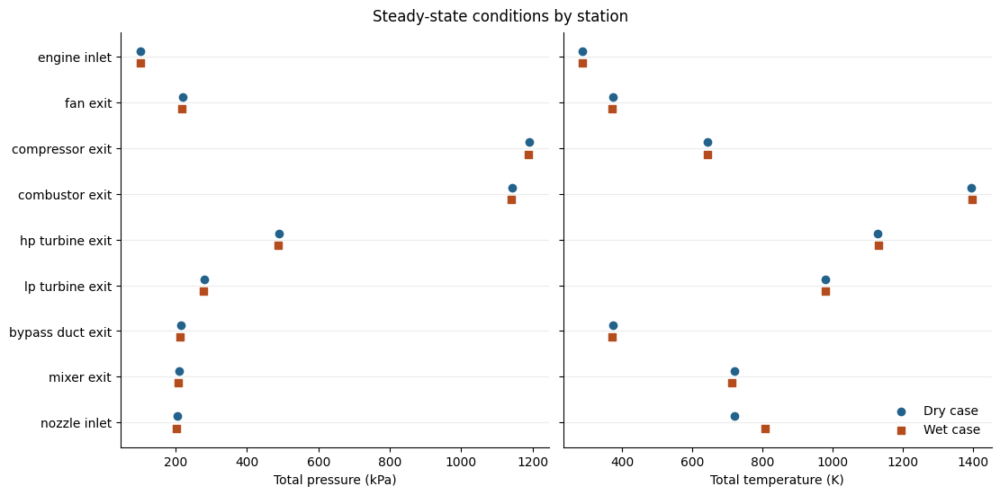

# Turbofan Afterburner Simulator

A C++20 simulator that computes the thermodynamic state at each station of a twin-spool turbofan with afterburning. A single nonlinear solve matches component flows, mixer pressure, nozzle capacity, and the power balance on both shafts.

**[Open the executed notebook](notebooks/turbofan_analysis.ipynb)** for station plots, T–s and p–v diagrams, and a comparison with NASA flight data.



- **Steady and transient simulation** with configurable component maps, rotor dynamics, actuator lag, and a sampled reference controller.
- **13 automated tests** covering component physics, cycle matching, transient response, and the public-data comparison.
- **Model scope.** The included maps and controller are synthetic. NASA reports provide reference data for selected F100-PW-100 flight conditions. [Comparison and limitations](docs/pw100-public-comparison.md)

## Build and run

Requires CMake 3.20 or newer and a C++20 compiler.

```sh
cmake -S . -B build -DCMAKE_BUILD_TYPE=Release
cmake --build build --parallel
ctest --test-dir build --output-on-failure

./build/turbofan-cli design > dry.csv
./build/turbofan-cli wet > wet.csv
./build/turbofan-cli controlled > transient.csv
./build/turbofan-cli compare-pw100 > comparison.csv
```

## Documentation

[Notebook guide](docs/notebook-analysis.md) · [Engine cases](docs/engine-cases.md) · [Component maps](docs/component-maps.md) · [Transient simulation](docs/transient-simulation.md) · [Controller profiles](docs/control-profiles.md)
