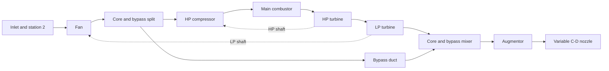

# Thermodynamic simulation plan

**Status:** Steady [dry](dry-cycle.md) and [lumped wet](wet-cycle.md) milestones implemented with synthetic data. [External rectilinear map loading](component-maps.md) is available with synthetic geometry and initial conditions.

**Target:** An offline C++20 simulator for the station-by-station thermodynamic states of a twin-spool, mixed-flow, afterburning turbofan. The first reference configuration is the F100-PW-100 DEEC test engine described by Myers. The F100 EMD/PW-1128 is a separate configuration and a secondary source of qualitative behavior.

**First deliverable after review:** A steady-state dry gas path, driven by specified fuel flow and geometry, with a transparent matching solver and test data whose provenance is visible in every result.

## 1. What the reports establish

The uploaded PDFs are sources for the engine layout, terminology, and reported behavior. Equations proposed in this plan come from conservation laws and standard component models. The engine-specific calibration must come from separate data. Page references for the 1984 memo use PDF page numbers. References for the Myers paper use its printed numbering, pp. 33–53 (PDF pp. 1–21).

### NASA TM-86040, 1984 — HIDEC on the F-15

| Location | What the source establishes | Use in the simulation |
| --- | --- | --- |
| PDF pp. 3–5 and Figs. 1–3 | Defines EPR as `PT6M/PT2`. The F100 EMD is the PW-1128, with a redesigned fan, revised compressor and combustor, single-crystal hot-section parts, and a 16-segment augmentor with light-off detection. The DEEC controls fuel streams, bleeds, variable geometry and nozzle area, with airflow and EPR feedback and an FTIT limit. | Record the measured signals and actuators in a separate EMD configuration. Keep the EMD augmentor and compressor calibration separate from the PW-100 test configuration. |
| PDF p. 5 and refs. 11–12 on p. 7 | The HIDEC work used an external full aerothermal **steady-state performance deck** and an external **linear state-variable dynamic model**. The steady deck takes inlet pressure, temperature and power setting and reports quantities including thrust, fuel flow and stall margin. The dynamic model interpolates between local linear models at different flight conditions and power settings. | Choose a nonlinear component plant for station states. The paper's interpolation concerns the local dynamic models and supplies neither their matrices nor the component maps. |
| PDF pp. 5–6 and Figs. 4–6 | HIDEC predicts inlet distortion and computes allowable uptrim from an engine stability budget. Engine airflow feeds back into the inlet-distortion estimate. Fig. 5 is an inlet-distortion example at Mach 1.6. Fig. 6 shows two stability audits. | Keep the aircraft-level feedback outside the gas-path solver. The plotted slices cannot define a compressor map or surge line. Use a prescribed inlet boundary for the first build. |
| PDF p. 6 and Figs. 7–8 | The EMD steady deck shows integrated changes in nozzle area, FTIT, fan stall margin and net thrust when the EPR request is changed. The dry example is a low-speed, low-altitude intermediate-power case. The augmented example is a subsonic, high-altitude maximum-power case. Detailed boundary conditions and station states are unavailable in the plots. | Use the figures as qualitative checks for an EMD configuration. Any digitized points need units, operating-case tags and reading uncertainty. Keep these trends separate from PW-100 acceptance tests. |
| PDF pp. 6–7 and Figs. 9–12 | Fig. 9 is a linear-model transient with DEEC response omitted. Fig. 10 summarizes uptrim estimates. Figs. 11–12 concern flightpath management. | Use Fig. 9 only as a limited example of a simulated transient. Aircraft-level optimization is outside the thermodynamic project. |

The text on PDF p. 6 reports that the Fig. 7 dry case reaches a 2.7 ft² nozzle area limit as net thrust goes from 12,720 to 13,740 lbf, FTIT rises by 29 °C, and fan stall margin falls from 25% to 15%. The Fig. 8 wet case goes from 4,050 to 4,585 lbf, with fan margin down to 3% at the reported 15% EPR increase. These numbers describe an external EMD deck at the reported conditions. They illustrate the direction and scale of its response. Fig. 9 shows the modeled response to a 1.1 s increase and 0.3 s removal. The text cites Fig. 8 for a comparison whose low-altitude context resembles Fig. 7, so retain that source ambiguity if digitizing it.

References 11 and 12 identify Pratt & Whitney **FR-16212**, March 1983, the user manual for deck **CCD 1194.2**, and **FR-17738**, September 1983, the user manual for **CCD 1227**. These are leads for PW-1128 work. Obtain the actual arrays and an operating-point input/output dataset before relying on either model for quantitative checks. A user's manual may only describe how to run the model.

### Myers, NASA record 19860015874 — F100-PW-100 DEEC

| Printed pages | What the source establishes | Use in the simulation |
| --- | --- | --- |
| 33–35 | Full-authority digital control with hydromechanical backup. The documented test engine, serial 680063, is a rebuilt F100(3) configuration. It has a reported bypass ratio of 0.8, a three-stage fan driven by a two-stage LP turbine, a ten-stage HP compressor driven by a two-stage HP turbine, variable CIVV and RCVV, a start bleed, and a variable convergent-divergent nozzle. Its five augmentor segments feed core rings 1/2/4 and duct rings 3/5. This test article also had dual igniters and a ducted core flameholder. | Reference topology. Treat 0.8 as a reported nominal ratio. Solve the off-design split. Model the start bleed, ignition hardware, and flameholder crossflow when their data are available. Aggregate turbomachinery by component for the first cycle model. |
| 36–38 | Signals include `PS2` (static), `TT2` (total), `PB`, `PT6M` (total), `FTIT`, `N1`, `N2`, `PLA`, light-off detection, and position feedback. Actuation includes main fuel `WFGG`, core/duct augmentor fuel `WFAC/WFAD`, sequencing valve position `SVP`, `AJ`, vane positions and start bleed. | Use distinct plant, sensor and actuator interfaces. Preserve total and static pressure as distinct quantities. FTIT is fan turbine inlet temperature, with its sensor location tracked separately from main combustor exit temperature. |
| 39–47 | Metering valves, resolver feedback, nozzle actuation and computer hardware are described. The computer summary lists 79 schedules and 500 constants. | Several hardware outputs have their own position loop. Start with imposed actual positions. Model response rates or lags when identified. The counts do not supply values, grids, gains or thresholds. |
| 48–50 | Main fuel normally closes the `N1` loop, with `N2`, `FTIT`, and `PB` limits. The p. 50 diagram shows a `WF/PB` base schedule, PI contributions and multiplication by `PB` before core control. At intermediate/military power and above the nozzle generally regulates EPR. At high Mach (p. 48 says above 1.4), when fuel is controlling FTIT, the nozzle regulates corrected fan speed. At lower power the nozzle follows an area schedule. Augmentor fuel targets are scheduled open loop, with local closed-loop valve positioning. | Implement these as optional controller modes after the plant works. The figures describe the structure. Mode boundaries, limit arbitration, gain signs in the implemented convention, schedules, and actuator dynamics require their own evidence or explicitly synthetic test settings. |
| 50–51 | The `PT2` estimator uses `PS2`, `TT2`, `N1`, and EPR, while EPR itself uses `PT2`. The p. 50 nozzle schedule shows inputs `FA·AB`, `TT2`, `PT2` and `PLA·AB`. P. 51 schedules CIVV with `N1C2`, RCVV with `N2C25` and `TT2`, and start bleed with `N2` and `TT2`. Its `N2C25` calculation receives `N1C2`, `N2` and `TT2`. | Start with plant `Pt2` and actual local station temperatures. CP 2298 Paper 5 documents the iterative pressure estimator. A later emulation can use an isolated scalar solve once both input correlations are available. Keep vane and bleed schedules replaceable. |
| 48–49, 52–53 | Describes start control, stall and blowout detection, and fault detection and accommodation (FDA). | Record their interfaces for traceability. Startup, flameout, fault logic and backup control are outside the initial thermodynamic envelope. |

### DEEC and the additional evidence

DEEC means Digital Electronic Engine Control. It belongs in the simulation as a controller connected to sensors and actuators. Its schedules can determine actuator positions and fuel flows at a steady operating point. Component efficiencies, flow capacities, and geometry remain plant data. Introduce a separate actuator input provider so that the first C++ cycle can run with prescribed inputs and the same plant can later run closed loop.

NASA CP 2298 includes the Myers paper above and additional sensor, altitude-test, augmentor and nozzle studies. Its nomenclature identifies `FA-AB` as the afterburner fuel-air ratio and `PLA-AB` as the afterburner power lever angle. `WFAD` is the duct fuel flow. The nomenclature supplies names and meanings for the nozzle schedule inputs. The schedule grids, interpolation conventions and exact fuel-air normalization still need calibration evidence. [DEEC evidence and validation plan](deec-evidence-and-validation.md)

## 2. Plant, signals, and model inputs

Implement a component-level, zero-dimensional, steady/quasi-steady model. Use SI internally. Provide a station table containing total pressure and temperature, mass flow, specific enthalpy, and composition or fuel-air ratio. Report static pressure, temperature and Mach where an area or a static-flow closure actually determines them. Carry baseline versus EMD identity, calibration provenance, and the solve status in every exported result.

Use internal station names and map them to the PW-100 station crosswalk in CP 2298 Paper 13, p. 218. Document any remaining signal-to-station assumptions. In particular, confirm the `PT6M` measurement or effective station and the meaning of `AJ` in each dataset before comparing an internal mixer pressure or geometric throat area with those signals.

The diagram uses a lumped augmentor downstream of an equivalent mixer. A later variant resolves fuel addition, flameholder transfer, and mixing in the core and duct streams separately. Confirm the axial order, station definitions and loss model before claiming stream-resolved results.

| Block | First implementation and needed inputs | Evidence needed for a variant-specific model |
| --- | --- | --- |
| Ambient and inlet | Accept an explicit ambient static pressure and an inlet total state, or derive totals from ambient pressure/temperature and Mach under a documented gas model. Apply a specified inlet total-pressure recovery. | Inlet recovery versus condition, station 2 definition, and optional geometric inlet/PS2 data. |
| Fan, splitter and HP compressor | Lookup corrected flow, total pressure ratio and isentropic efficiency by corrected speed and map coordinate. Use the ratio and efficiency with inlet enthalpy/entropy to obtain outlet state and shaft load. Begin with an equivalent common fan exit, then let mixer compatibility determine the division of core and bypass flow. | Fan and HPC grids, design anchors, reference conditions, possible separate fan tip/hub treatment, CIVV/RCVV angle dependence, validity limits and surge lines if available. |
| Main combustor | Add `WFGG` to mass continuity, heat the flow with a consistent fuel heating value and efficiency, apply pressure loss, and invert enthalpy for outlet temperature. Keep an explicit fuel/air or composition record. | Burner pressure loss/efficiency, fuel model, and cooling/extraction routing. Add bleed extraction and turbine cooling return in stages with mass and enthalpy accounted for at their own boundaries. |
| HP and LP turbines | For a proposed expansion ratio, query corrected swallowing capacity and efficiency. Compute outlet enthalpy from the isentropic drop and efficiency, and the shaft power from mass flow and enthalpy drop. | Separate turbine capacity and efficiency grids, pressure-ratio convention, shaft losses, cooling, and accessory load. |
| Bypass duct and mixer | Apply duct losses. Use specified effective entry areas to recover branch static states on the subsonic branch. Enforce a common static pressure at the matching plane. Conserve mass, composition and total enthalpy through mixing. Start with a documented effective pressure-loss closure for mixed total pressure and verify passivity and admissibility. | Hot and cold entry/mix areas and a mixer loss model calibrated for the variant. A later momentum-based mixer needs explicit areas, forces/losses and consistent static closure. |
| Augmentor | Dry mode sets augmentor fuel to zero and retains specified dry pressure loss. Wet mode adds prescribed core/duct fuel totals to the equivalent heat and mass balance with separate wet loss calibration. | Fuel split and schedules, segment transitions, burn efficiency/pressure loss, mixing geometry and oxygen availability for a resolved model. Do not add heat when a wet case has invalid fuel/oxidizer inputs. |
| Variable C-D nozzle | Calculate capacity from inlet total state, effective throat/exit geometry, discharge factor and ambient pressure for a physically supported flow regime. Start with convergent-equivalent capacity and verify choked/unchoked transitions. Then add exit area and C-D expansion, including a clear limit on regimes supported for exit outputs. | Throat and exit geometry relationship, area calibration versus `AJ`, flow coefficients, and regime data. A choked throat does not guarantee a fully isentropic supersonic exit at every back pressure. |
| Shafts and engine measures | Match HP turbine power to HP compressor demand and LP turbine power to fan demand, allowing for mechanical efficiency and any declared loads. Export `N1/N2`, pressure ratios and fuel flows alongside station states. | Shaft inertias for transients, sensor mappings for `PB`, FTIT and `PT6M`, and traceable efficiency/loss values. Compare EPR only after the pressure taps are mapped. |

Use total-to-total efficiency for the first component models. For a compressor, find the isentropic outlet enthalpy `ht_s` at the map outlet pressure and inlet entropy, then use `ht_out = ht_in + (ht_s - ht_in) / eta_c`. For a turbine, use `ht_out = ht_in - eta_t * (ht_in - ht_s)`. Gas power is mass flow times the actual enthalpy rise or drop. Model shaft losses and heat addition explicitly. An adiabatic mixer without shaft work closes `W_mix * ht_mix = W_core * ht_core + W_bypass * ht_bypass`, with `W_mix = W_core + W_bypass`. This energy balance leaves a separate pressure closure.

Use one internally consistent gas model in each run. Begin verification with calorically perfect gas cases. Introduce temperature- and composition-dependent `h(T)`, `s(T,p)`, and `R` before interpreting wet high-temperature results quantitatively. For a prescribed fuel heat release, use a consistent sensible-enthalpy reference with an explicit heating value. If using species formation enthalpies in a chemistry model, use its chemical energy balance instead of adding the same energy again. An independent public chemistry tool can check selected reference states. [NASA CEA](https://github.com/nasa/CEA)

## 3. Resolve the circular dependencies in one matching solve

The nozzle and mixer feed pressure and flow constraints back through the whole gas path. Turbine work sets spool speeds, and spool speeds change the compressor points the turbines must drive. The component chain can evaluate at trial values. It cannot determine those trial values by recursively calling downstream components.

One proposed steady off-design formulation for the equivalent mixer, fixed actuators, and a dry or lumped-wet case is:

| Trial values (8) | Independent matching conditions (8) |
| --- | --- |
| Inlet air flow and bypass mass fraction | Corrected-flow match at the fan and HP compressor (2) |
| Fan and HP compressor map coordinates | Corrected-flow match at the HP and LP turbines (2) |
| HP and LP turbine expansion ratios | Core versus bypass static-pressure equality at the mixer entry (1) |
| LP and HP spool speeds | Gas-path flow versus nozzle capacity (1), and net HP and LP shaft powers equal to zero (2) |

The columns count unknowns and residuals separately. Each trial value can affect multiple residuals. A component receives immutable inlet data, trial variables and geometry. It returns its outlet state, power/capacity if relevant, and any validity flags. The splitter and reaction blocks enforce their mass bookkeeping directly. The solver owns the coupled matching conditions and reports each residual by name.

For maps using `theta = Tt / T_ref` and `delta = Pt / P_ref`, typical axes are `Nc = N / sqrt(theta)` and `Wc = W sqrt(theta) / delta`, using each component's inlet total state. Check the actual dataset convention, especially turbine flow parameters and normalized speeds. Match flow after fuel additions, bleeds and cooling returns at their correct stations.

- Establish a consistent reference design point, with specified design pressure ratios, efficiencies, split and losses. Solve the required flow areas and/or map scales where enough independent design data exist. Freeze those fitted parameters when solving off design. A design datum of bypass ratio 0.8 cannot constrain the off-design split and also leave a free mixer matching equation without changing the formulation.
- Start from the design point and continue in small increments of inlet state, fuel and area. Reuse the last converged operating point as the next initial guess. Use a bounded, damped Newton or trust-region solve, a scaled finite-difference Jacobian initially, and explicit handling of domain boundaries and nozzle regime changes.
- Scale flow, pressure and power residuals by documented reference magnitudes. Treat any active invalid map, unphysical state or unresolved residual as a failed operating point, even if the step size is small. Report the failing component, map coordinates, residuals, iterations and last valid point. Set acceptance tolerances from numerical repeatability and the precision of the underlying data.
- If a specified EPR or shaft-speed target replaces a prescribed actuator, add the actuator as an unknown and the target as a residual. A throttle angle by itself needs a mode and a schedule that maps the command to a target or actuator setting. For a dynamic DEEC model, update sampled controller state outside the inner plant solve. Account for actuator lag separately. Sensor synthesis and airplane-level feedback have their own timing and data requirements.
- For transients, use converged steady states as initial conditions. Prescribe both spool speeds during each algebraic evaluation and replace the two instantaneous shaft-balance equations with differential shaft dynamics, `J * omega * d(omega)/dt = Pnet`, in the positive-speed operating envelope. Integrate those states while re-matching the gas path. Startup from near zero, surge and volumes that store mass or energy require additional equations and data.

## 4. Maps, interpolation, and calibration

| Data for the project | Minimum use | Current status |
| --- | --- | --- |
| Fan/HPC maps `(Nc, Rline or equivalent[, geometry]) -> (Wc, PR, eta)` and HPT/LPT maps `(Nc, expansion ratio[, geometry]) -> (Wc, eta)` | Off-design matching | Missing for both F100 variants in the supplied documents. |
| Design reference `Pt2/Tt2`, ambient pressure, inlet flow and bypass ratio, shaft speeds, component pressure ratios/efficiencies, fuel flows and station states | Scale maps and check identifiability | The reports give a topology and isolated nominal quantities or plots, without a complete common reference case. Acquire enough independent measured quantities to constrain the chosen unknowns. |
| Mixer/duct/burner pressure losses, cooling and start bleed flows, nozzle and mixer effective areas, fuel properties | Close balances and produce useful station outputs | Generic assumptions can exercise the software. Record each such assumption and its uncertainty. Do not label synthetic settings as F100 calibration. |
| DEEC schedule grids and gains, limits, sensor conversions, actuator rate and lag data | Control or detailed transient reproduction | Myers and CP 2298 give interfaces, selected logic and timing, and a plotted CIVV schedule. The complete F100 calibration set is still missing. Use prescribed controls in the steady plant. |
| Several independent station or deck datasets at documented operating conditions | Validation | TM 84903 provides PW-100 flight and steady-deck comparisons for several observable outputs. Obtain station data and retain holdout conditions to validate internal states. |
| Spool inertias and time histories with known fuel and nozzle inputs | Dynamic validation | CP 2298 supplies selected control and augmentor traces. Spool inertias and full input histories are still needed for complete dynamic validation. The HIDEC Fig. 9 example omits the DEEC response. |

NASA T-MATS has inspected, publicly accessible **JT9D** examples with numerical fan, HPC, HPT and LPT maps. They are suitable as import and interpolation fixtures and as references for component or solver structure. Their geometry and separate-nozzle topology differ from this project. Integrate synthetic maps and geometry as a consistent mixed-flow cycle fixture first. If a generic map is scaled later, document scaling separately, require reference anchors for each component, and label every result as a surrogate. [NASA T-MATS JT9D maps at the inspected revision](https://github.com/nasa/T-MATS/tree/ad6e4d5d0d76c229db4eb72ca40ef58d5ddc4014/Resources/JT9D_Public_NPSSv241/Maps_and_Elements)

OpenMDAO pyCycle also has a worked two-spool, mixed-flow afterburning example and a numerical benchmark with a booster stage. Its off-design matching ties airflow to throat area, bypass ratio to mixer static-pressure compatibility and shaft speed to shaft power balance. It solves fuel/air ratios against specified temperatures, whereas our first case uses prescribed fuel. Use the example to review matching structure and to compare results only under aligned topology, boundary conditions and property assumptions. [Example model](https://github.com/OpenMDAO/pyCycle/blob/ee7e16126a7a54b5fe35292c53b7eb4e9572620b/example_cycles/mixedflow_turbofan.py) · [Benchmark data](https://github.com/OpenMDAO/pyCycle/blob/ee7e16126a7a54b5fe35292c53b7eb4e9572620b/example_cycles/tests/benchmark_mixedflow_turbofan.py)

For PW-100 data, search for variant-specific reports, operating decks or station test records with tables as opposed to topology-only papers. For the PW-100 comparison in TM 84903, follow reference 3 for deck CCD 1148.0, based on FX-227. Follow FR-16212 and FR-17738 separately for the PW-1128. Access to NASA NTRS from this environment returned HTTP 403, so the availability and contents of additional records and manufacturer decks remain unverified. [DEEC paper](https://ntrs.nasa.gov/citations/19860015874) · [HIDEC memo](https://ntrs.nasa.gov/citations/19840016519)

Store maps as versioned tables with a manifest for engine variant, units, axes, speed and flow correction references, pressure-ratio orientation, valid cells, source revision/page, preprocessing and license. Validate strictly increasing axes, dimensions and finite values on load. Use linear/bilinear interpolation on rectangular grids, with an explicit geometry dimension only when supported by the data. For nonrectangular speed lines, preserve their topology and valid boundaries before deciding on a resampling method. Reject out-of-domain queries by default. Test exact nodes, interstitial points, axes and corners, masked regions, and failure outside the domain. Any extension toward a boundary needs its own model and status. Report stall margin only with a compatible stall line and definition.

## 5. Implementation and verification sequence

Use a C++20 library with a CMake-built command-line runner and CTest. Keep the thermodynamic components independent of the map loaders, the nonlinear solver, and the optional controls. Give the CLI a variant data manifest plus a case file. Export one station table and one convergence summary per run. Choose a numerical library after measuring the small reference problem if a native implementation or an existing library would simplify verification and maintenance.

| Phase | Work and exit criteria |
| --- | --- |
| 0. Evidence and case definition | Agree on the PW-100 first target or switch explicitly to the PW-1128. Record each station, symbol, units and source. Classify each input as a plant parameter, prescribed actuator value, boundary condition, DEEC schedule, or observed output. Define one fully specified synthetic dry design case and the outputs for comparison. |
| 1. Properties and independent blocks | Implement properties, inlet, prescribed compressor/turbine operating points, dry duct, combustor energy balance and nozzle capacity. Verify against hand-calculated ideal-cycle, isentropic and choked/unchoked cases. Add tests for static versus total values and station-level energy closure. |
| 2. Map layer and dry matching | Load and test synthetic grids and selected T-MATS fixtures, then match the mixed-flow dry cycle with the eight-residual formulation. Verify design closure, independent mass/energy/shaft balances, convergence from perturbed initial guesses, off-design continuation, and explicit failure for invalid points. |
| 3. Afterburner and variable C-D nozzle | Verify dry-to-wet limiting behavior, fuel mass and heat addition, mixed-stream enthalpy, pressure loss, nozzle capacity and supported exit regimes. Begin with lumped reheat and imposed geometry. Add separate streams, sequencing or detailed nozzle modes only as their inputs become available. |
| 4. Variant calibration | Ingest attributable maps and station test/deck data. Fit only parameters identifiable from the available observations and report uncertainty. Validate on held-out conditions, publishing provenance and residuals. Until this gate is met, describe results as a generic or surrogate simulation and report the supported range. |
| 5. Dynamics and optional controller | Integrate rotor states, benchmark steady-state recovery and response to small imposed fuel/area changes, then add a sampled DEEC-like controller with a versioned parameter set, explicit sensor/actuator timing, and observable mode changes. Compare time-step refinements and measure execution latency against the intended update budget before making a real-time claim. |

The design point and one converged off-design dry case are the first integration milestones. Each result must state its variant and calibration level, which operating regimes were supported, and whether the physical residuals converged. Separate software verification with synthetic data from validation against a specific engine dataset.
